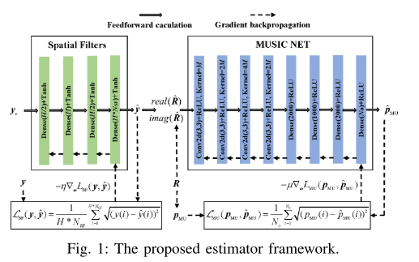
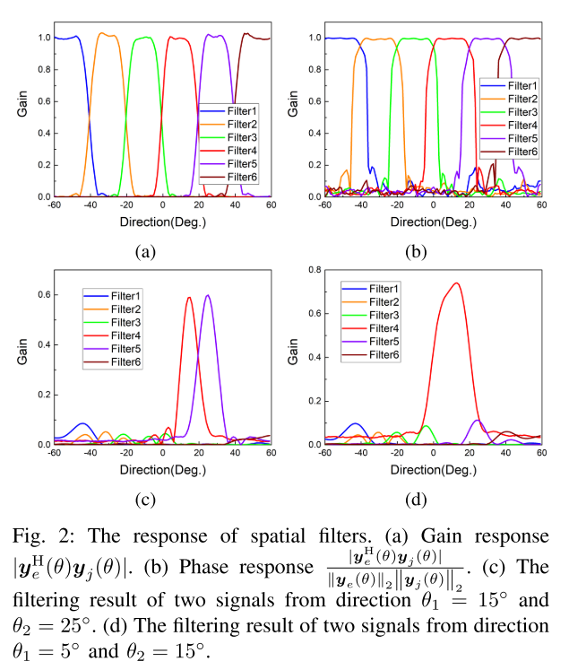
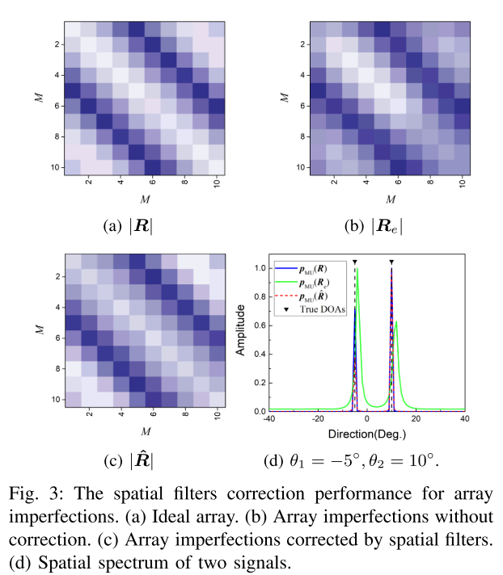
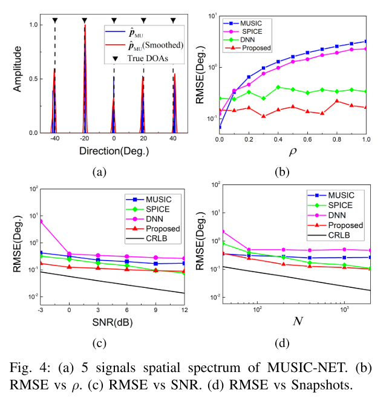

# DOA Estimation with Array Defect Adaptive Filtering Assisted Unsupervised Learning [Attached Code]

Introduction: DoA (Direction of Arrival) estimation has wide applications in radar, communication, sonar, and other fields [1]. Over the past few decades, numerous methods have been developed to tackle the challenges of DOA estimation, offering super-resolution, high accuracy, and adaptability to low SNR or small snapshot scenarios [2], [3], [4], [5], [6], [7], [8]. For example, the MUSIC method based on the subspace orthogonality assumption and the ESPRIT method using rotational invariant techniques have achieved super-resolution direction finding under low SNR conditions. The sparse induction method based on overcomplete guidance matrices [9], [10] uses a single snapshot to accurately find the direction by reconstructing the spatial spectrum into a linear weighted representation of an overcomplete basis. However, low-cost direction finding systems often encounter complex array defects such as antenna position disturbances, mutual coupling effects, and gain/phase inconsistencies. These defects make it challenging to establish a mathematical model from the array output to the signal direction, leading to significant performance degradation in model-based approaches [11].
Recent research has introduced deep learning techniques to address the DOA estimation challenge [12], [13], [14], [15], [16], [17], [18], [19]. These innovative methods do not rely on the geometric shape or calibration of the array. Instead, they leverage large training datasets with DOA labels to learn the probability distribution of signal direction from the array output. This enables estimating signal directions based on the array output for testing data, thereby enhancing adaptability to array defects. One method involves a framework for supervised pre-training of waveform direction estimation using an autoencoder that solves array defects with pre-trained data and then uses a large amount of labeled data to establish a mapping between array output and signal directions. Another method utilizes a large amount of labeled data to model the signal subspace and solve array defects, followed by accurate DOA estimation through spatial spectrum computation. The difficulty in obtaining large amounts of manually labeled data has prompted researchers (e.g., [22] and [23]) to propose developing beamforming fitting loss functions with sparse weight constraints. This innovative approach allows unsupervised training of DOA estimation networks, providing a promising solution for the challenges of collecting training data.
This paper derives a new DOA estimation algorithm based on the characteristics of the DOA estimation algorithm proposed by DOA. The framework consists of two independent networks, an adaptive spatial filter, and MUSIC-NET. Notably, the training of these two networks is completely independent. To train the adaptive filter, only a small amount of manually labeled data for each array is required. This facilitates the effective correction of complex array defects and recovery of the covariance matrix under ideal conditions using the Toeplitz structure. For MUSIC-NET, we designed a MUSIC spectrum fitting loss function. Subsequently, unsupervised training with synthetic data was used to map from the covariance matrix to the MUSIC spectrum. Finally, the two trained networks were concatenated to achieve high-precision DOA estimation for non-ideal arrays. Simulation results validate the effectiveness of the proposed method, and it is compared with existing DOA estimation methods, demonstrating superior DOA estimation accuracy.
The article includes illustrations.
Conclusion: The method effectively addresses the impact of complex array defects on DOA estimation by introducing a spatial filter. The developed MUSIC-NET autonomously learns to extract angle features from the covariance matrix using synthetic data, simplifying network training by replacing manual labels with the MUSIC spectrum. Compared to existing methods, this approach has superior adaptability and stability in handling array defects. It can provide good estimation performance even in low SNR and small number of samples, showing promising practical applications.

## Images

<!-- PAYMENT_BLOCK -->

## Get this dataset

- Payment link (Stripe): [Buy now](https://buy.stripe.com/3cs8yP7sY87d0vu9AB)
- Payment QR code: 

<!-- /PAYMENT_BLOCK -->
